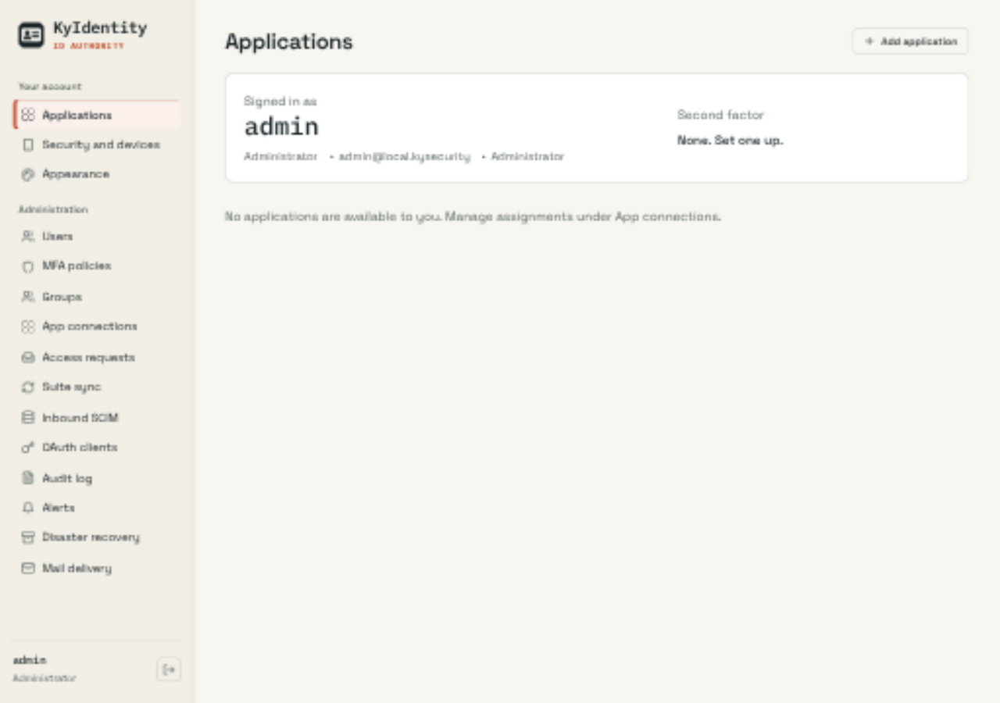
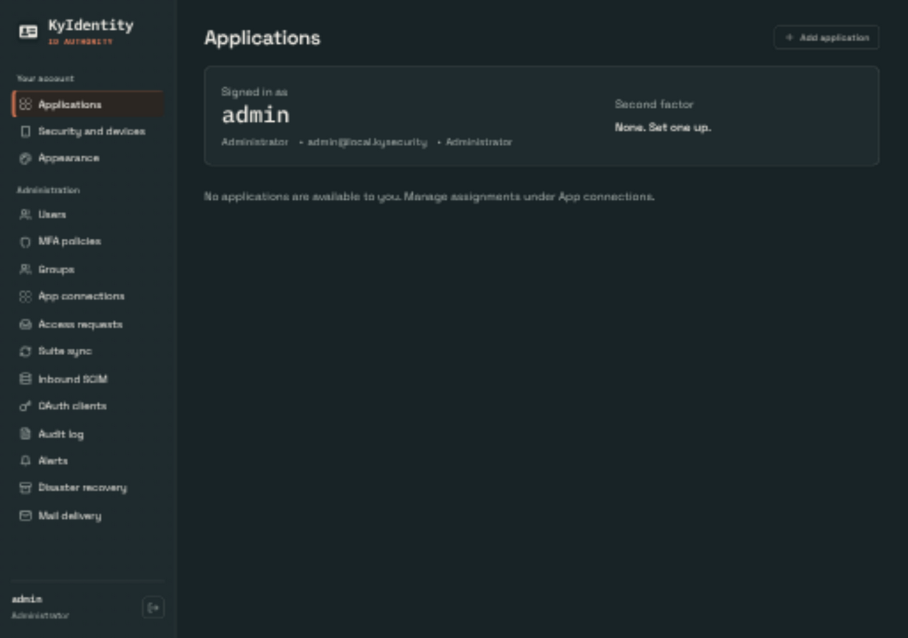
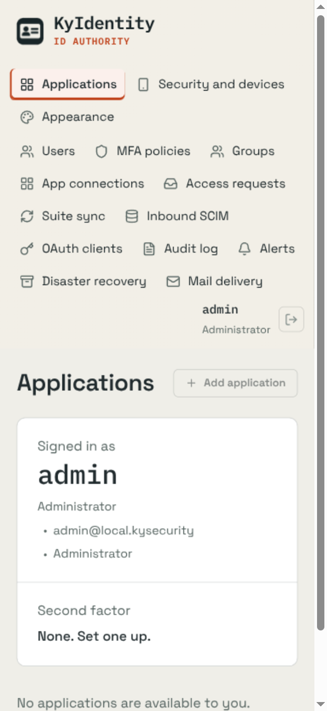
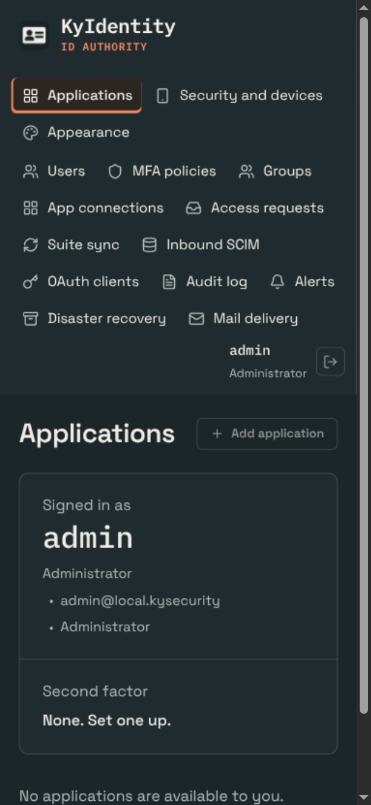

# Shared UI verification

> Evidence scope: this document records the revision, environment and capture conditions below. Screenshots and generated fixtures demonstrate appearance; they do not qualify live email delivery, push delivery, recovery custody or every product feature. Test counts describe that recorded run, not the current suite.

## Change

Generate Busnes palettes and share safe storage/cross-tab theme updates without changing named presets. Shared assets are pinned to ky-ui 0.2.0 with content hashes. Product layouts, saved theme keys and named presets remain local.

## Capture conditions

Captured 2026-09-25 from this branch, using the application UI (not a design mockup). Applications page in a real scratch server, signed in as the local preview administrator. No applications assigned.

OS-following Busnes Light and Dark were captured at 1280×900 and 390×844 CSS pixels. Browser device scaling may make PNG dimensions larger. Document width stayed within the viewport in these captured states; local navigation/table scrolling is intentional. Screenshots show the selected-page accent, not a complete accessibility audit.

No complete end-to-end product workflow or exhaustive named-theme audit is claimed.

## Checks

162 frontend tests and production build passed. Central ky-ui sync --check verified all ten consumers. Screenshot coverage is Busnes Light/Dark; existing named choices are retained, but not every named palette/page combination was visually exercised.

## Screenshots

| Light | Dark |
| --- | --- |
|  |  |
|  |  |

## Reproduce

Run npm ci, npm test (where configured), and npm run build in web/, then start the product with isolated local preview data following its README. Use System theme, emulate OS light/dark, and inspect both viewport sizes. Do not point preview instances at production data. For KyVault, use a configured development KyIdentity or explicitly labeled read-only browser fixtures; never bypass backend authentication.

## Approved interface polish — 2026-10-19

See [UI-POLISH.md](UI-POLISH.md) for the implemented changes, preservation scope, checks, actual before/after screenshots and disposable capture conditions. Earlier captures above remain historical evidence.

## Fleet Appearance — 2026-10-26

Shared ky-ui 0.4 Appearance radio cards over the suite catalog, plus the suite shell scale. Staged before/after captures (light/dark × 1280×900/390×844, synthetic fixture), manifests with revisions and hashes, in-app theme transition checks, CSV results and the recorded check runs are in [docs/ui-fleet-2026-10-26](docs/ui-fleet-2026-10-26/README.md). Scores are not self-assigned; the council rates the captures separately.
