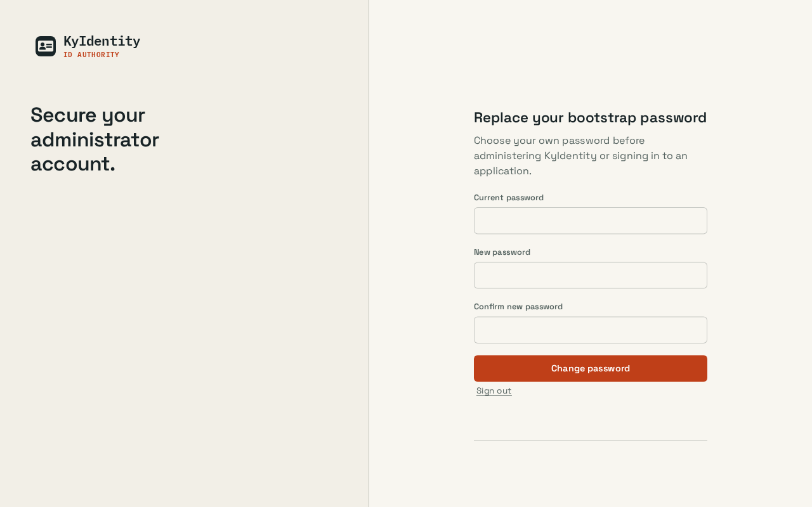
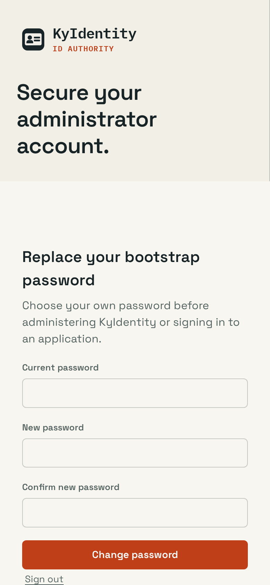

# Shared UI verification

## Change

Generate Busnes palettes and share safe storage/cross-tab theme updates without changing named presets. Shared assets are pinned to ky-ui 0.2.0 with content hashes. Product layouts, saved theme keys and named presets remain local.

## Capture conditions

Captured 2026-09-25 from this branch, using the application UI (not a design mockup). Applications page in a real scratch server, signed in as the local preview administrator. No applications assigned.

OS-following Busnes Light and Dark were captured at 1280×900 and 390×844 CSS pixels. Browser device scaling may make PNG dimensions larger. Document width stayed within the viewport in these captured states; local navigation/table scrolling is intentional. Screenshots show the selected-page accent, not a complete accessibility audit.

No complete end-to-end product workflow or exhaustive named-theme audit is claimed.

## Checks

162 frontend tests and production build passed. Central ky-ui sync --check verified all ten consumers. Screenshot coverage is Busnes Light/Dark; existing named choices are retained, but not every named palette/page combination was visually exercised.

## Screenshots

| Light | Dark |
| --- | --- |
|  |  |
|  |  |

## Reproduce

Run npm ci, npm test (where configured), and npm run build in web/, then start the product with isolated local preview data following its README. Use System theme, emulate OS light/dark, and inspect both viewport sizes. Do not point preview instances at production data. For KyVault, use a configured development KyIdentity or explicitly labeled read-only browser fixtures; never bypass backend authentication.

## Approved interface polish — 2026-10-19

See [UI-POLISH.md](UI-POLISH.md) for the implemented changes, preservation scope, checks, actual before/after screenshots and disposable capture conditions. Earlier captures above remain historical evidence.

## Bootstrap password replacement — 2026-10-19

Captured through T3's native browser against a disposable local server from this
source, with an isolated private data directory and a newly created bootstrap
administrator. Busnes Light at 1280×800 and 390×844 CSS pixels; device scaling
increases the mobile PNG dimensions. The new form uses the existing login layout,
labels and input classes. Vertical scrolling on mobile is intentional.

The actual browser flow completed sign-in, required password replacement,
password-only operation-bound step-up and replacement. Readback then showed
`passwordChangeRequired: false`, `role: admin` and HTTP 200 for the administrator
users API. The fixture was stopped afterward. Existing accounts are not flagged.
MFA enrollment, every named theme and an exhaustive accessibility audit were not
exercised in this capture. Frontend: 189 tests, typecheck and production build
passed; the source detector reported no findings.

| Desktop | Mobile |
| --- | --- |
|  |  |
