# Proxy apps (forward-auth), 2026-11-15

App connections gains a **Proxy apps** button. It opens the Proxy apps view: a list, the Add
proxy app dialog with its two warnings (login header and bypass paths), and the one-time edge
secret. "Before" was built from `origin/master` at 4886f23.

Driver: `capture.mjs` here. Each run starts from a fresh bootstrap with the relays off, on
port 5391, at 1440x900 and 390x844 in Busnes Light and Dark. No shot overflows horizontally.

| | Light | Dark |
| --- | --- | --- |
| App connections, before, 1440 | 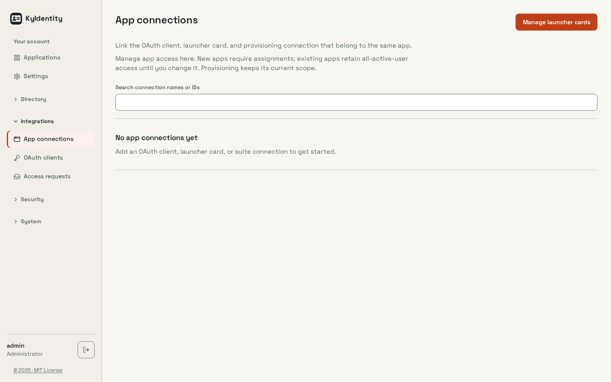 | 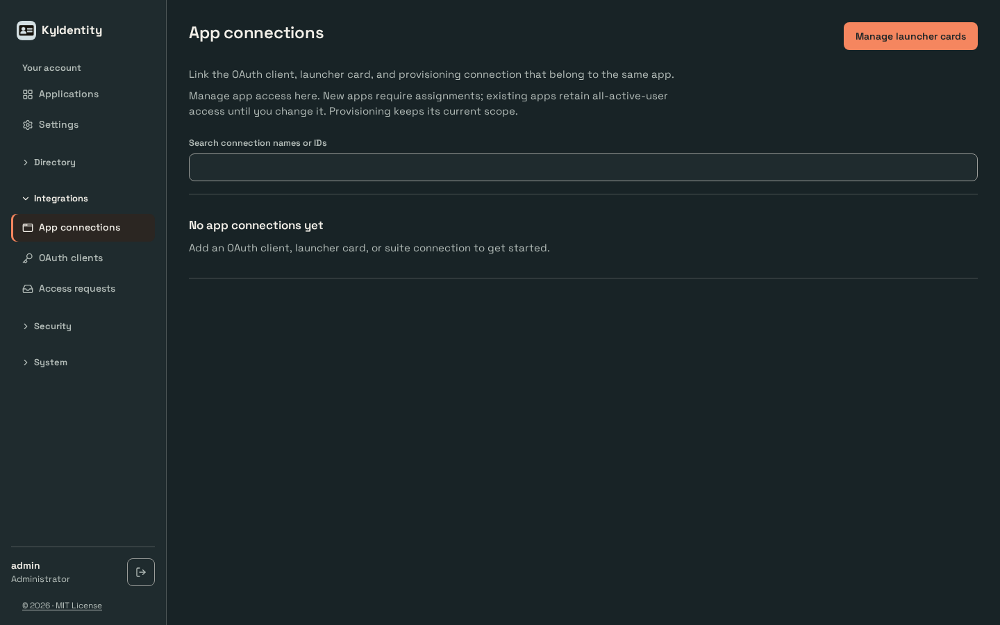 |
| App connections, after, 1440 | 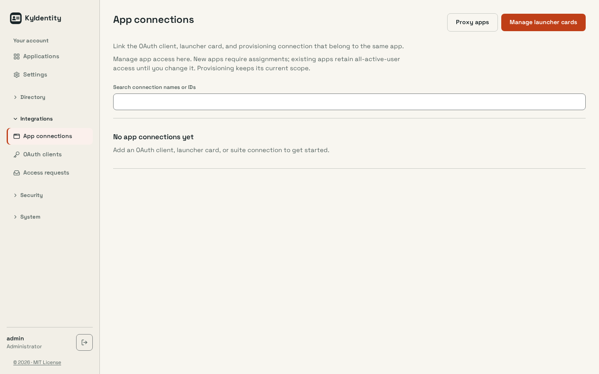 | 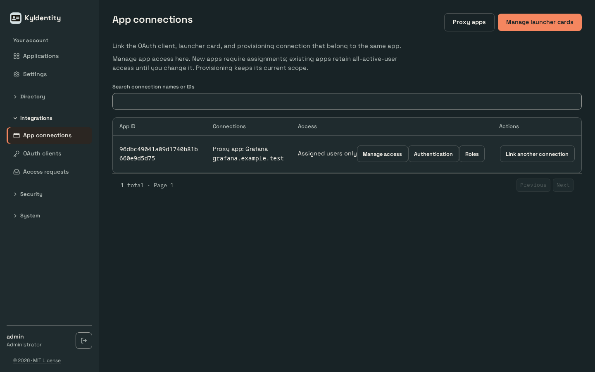 |
| App connections, before, 390 | 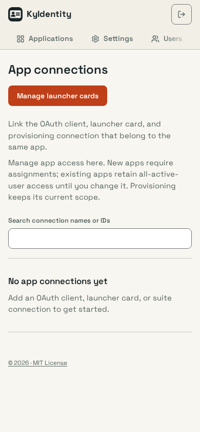 | 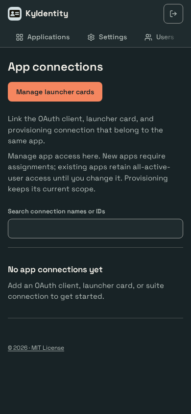 |
| App connections, after, 390 | 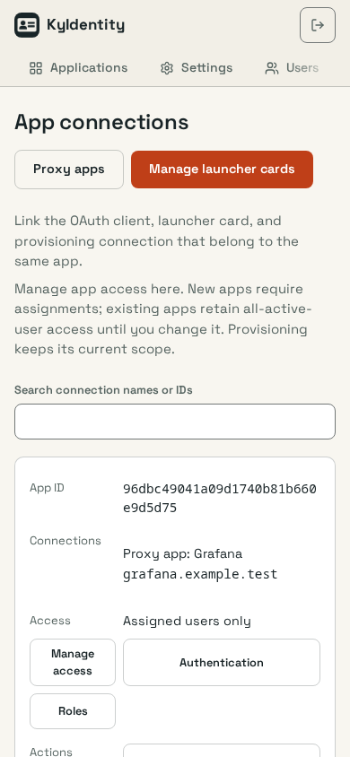 | 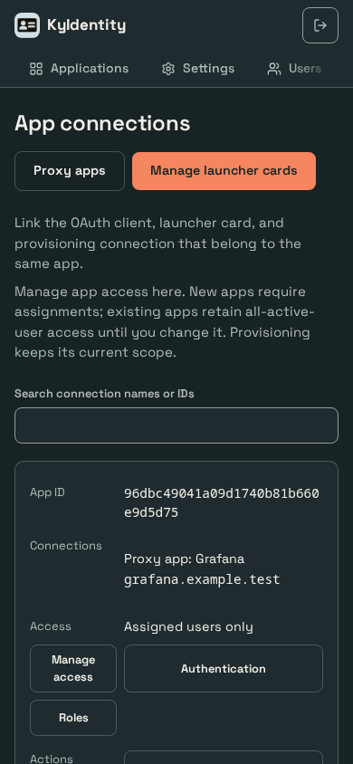 |
| Add proxy app, 1440 | 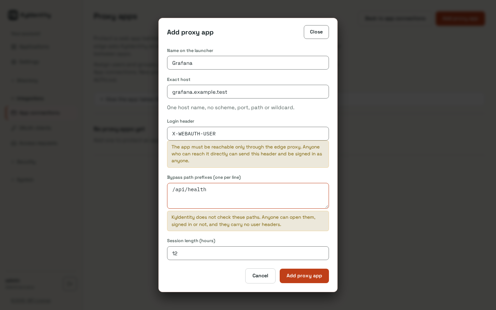 | 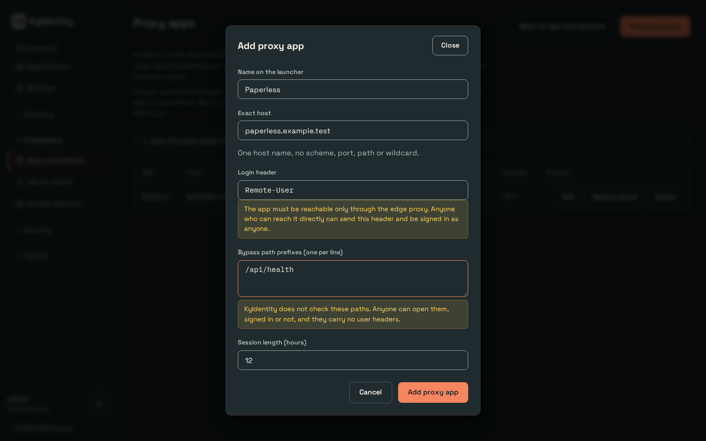 |
| Add proxy app, 390 | 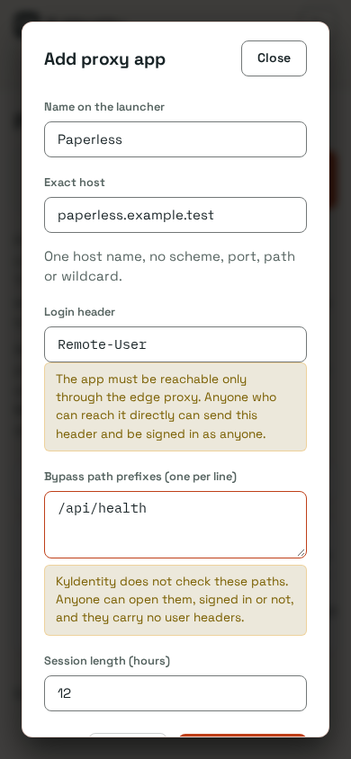 | 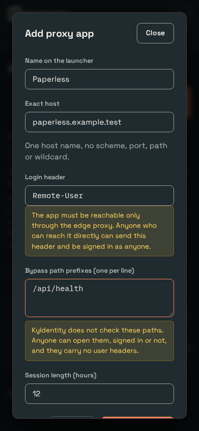 |
| Proxy apps list, 1440 | 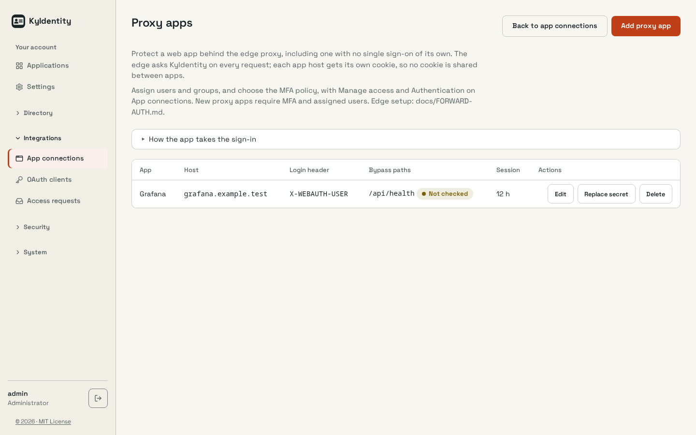 | 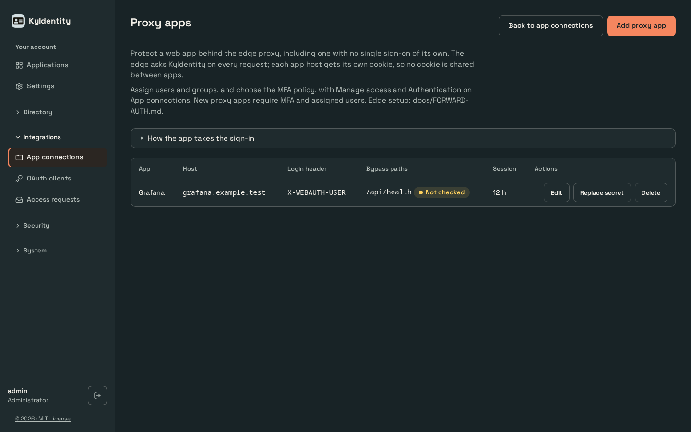 |
| Proxy apps list, 390 | 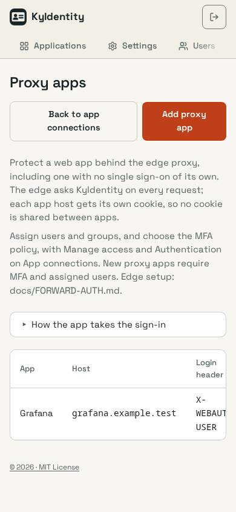 | 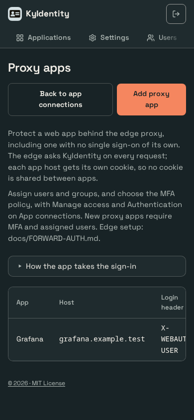 |

On a phone, the list table scrolls inside its card, as the other admin tables do.
