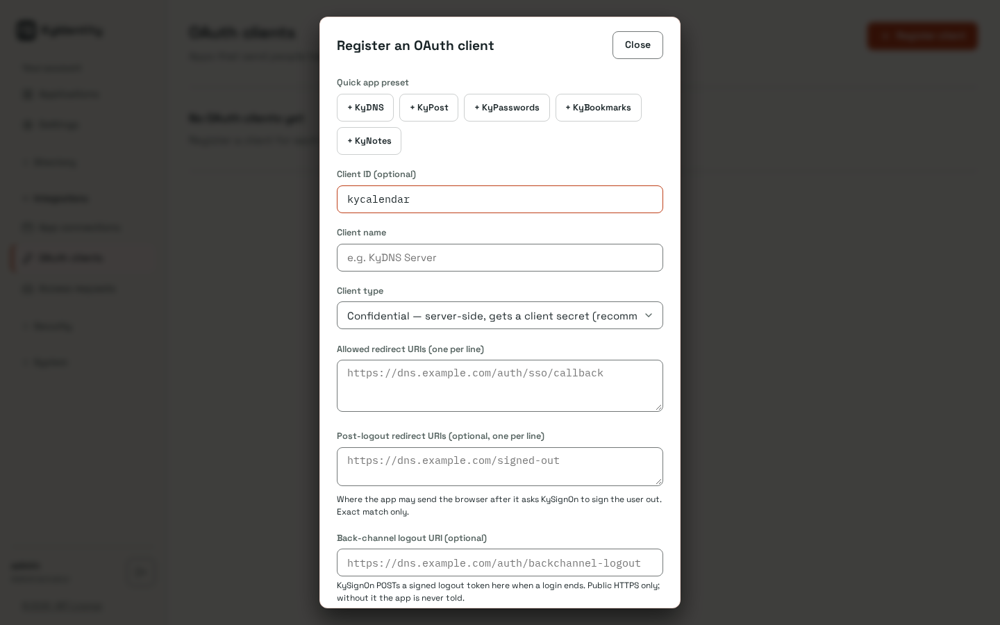
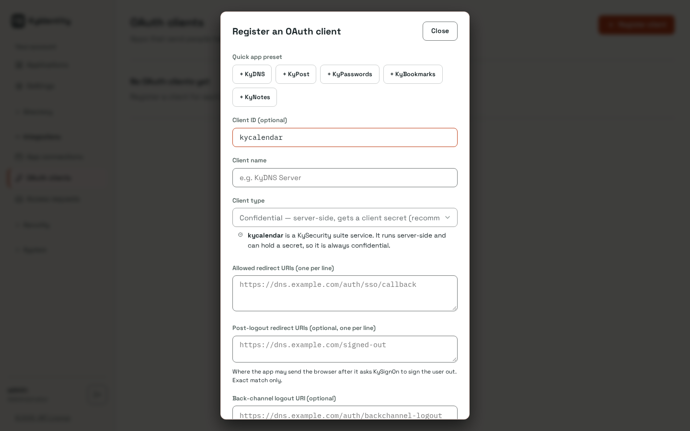
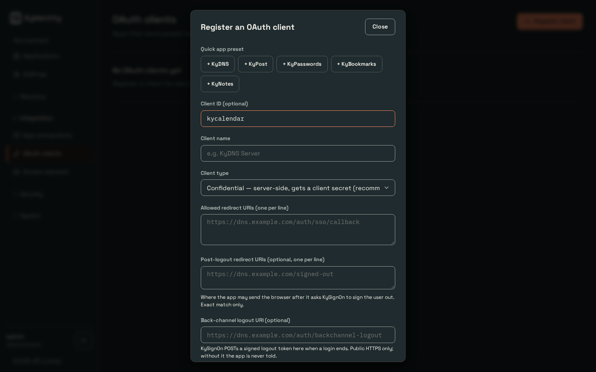
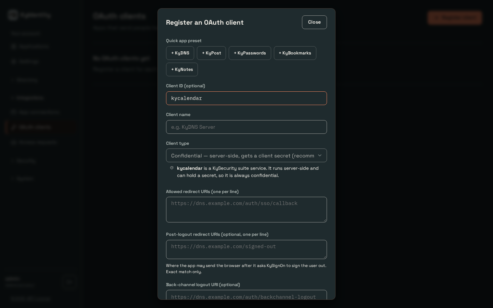
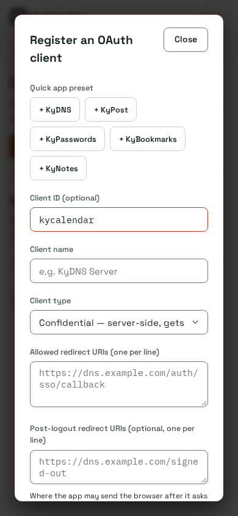
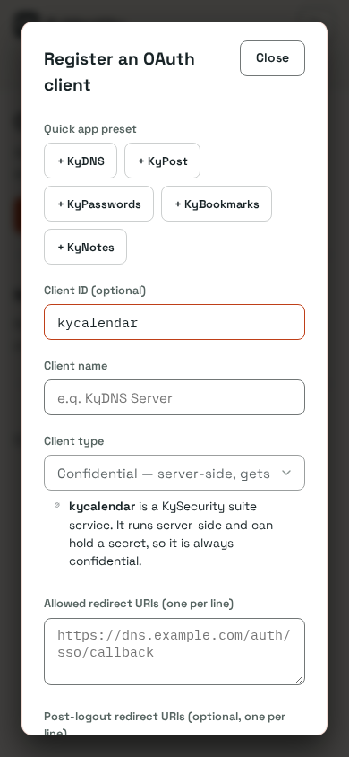
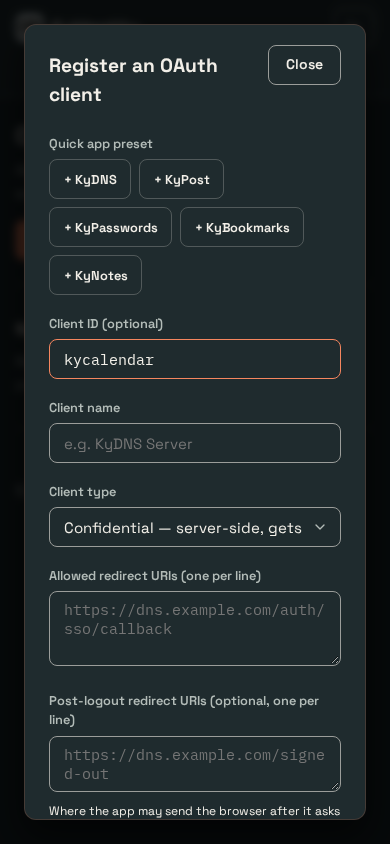
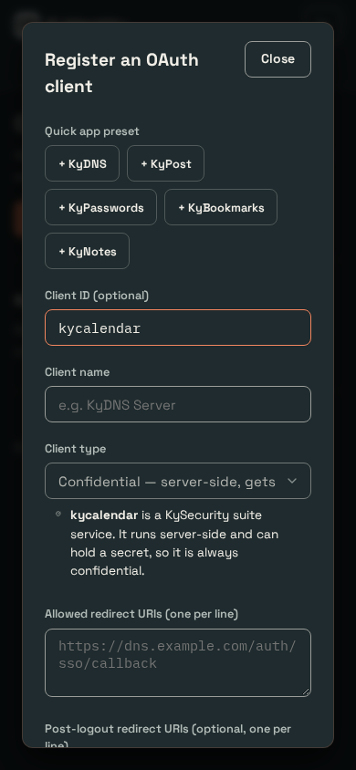

# Suite clients locked to confidential (2026-11-14)

Register an OAuth client with Client ID `kycalendar`. Before (built from `origin/master`
on 2026-11-14) the Client type select is free; after, it is disabled at Confidential
and the existing suite-service notice shows. The same holds for `kydrive` and `kymessage`.

Driver: `capture.mjs` here (fresh bootstrap, relays off, port 5391), at 1440x900 and 390x844,
Busnes Light and Dark. No shot overflows horizontally.

| | Before | After |
| --- | --- | --- |
| 1440 light |  |  |
| 1440 dark |  |  |
| 390 light |  |  |
| 390 dark |  |  |
