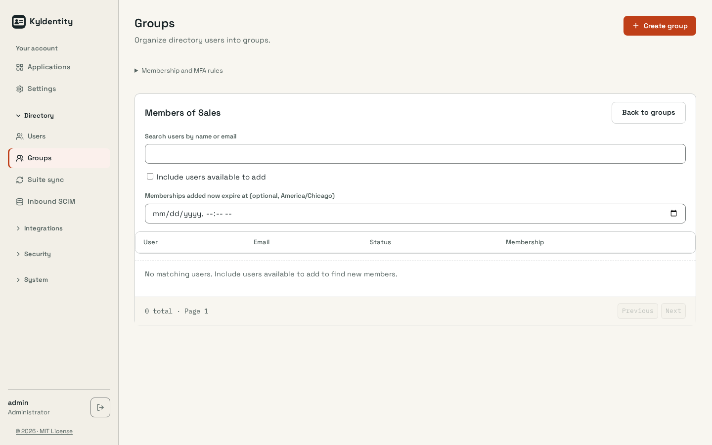
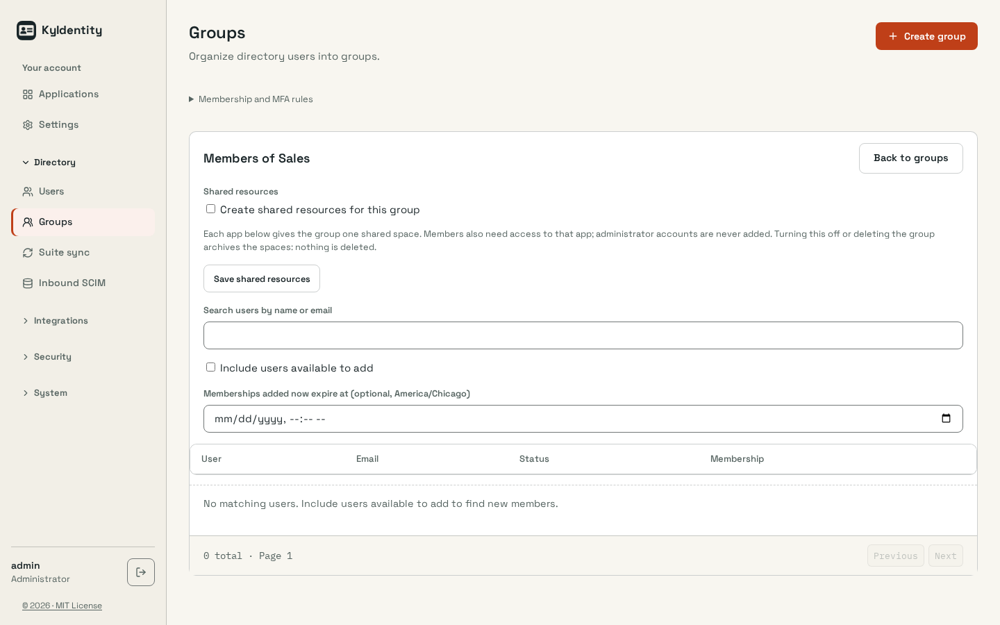
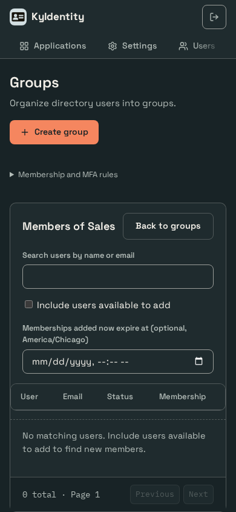
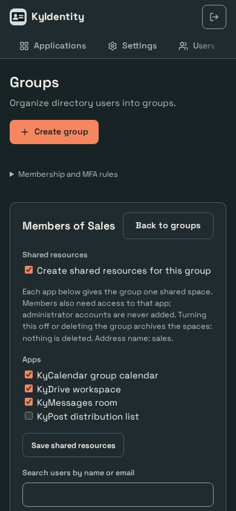
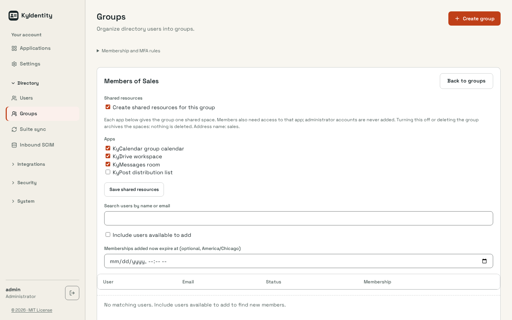
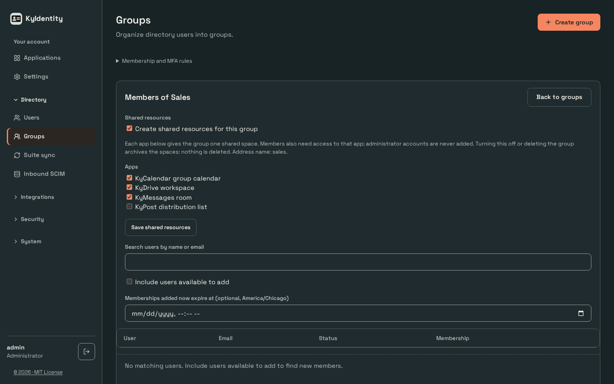
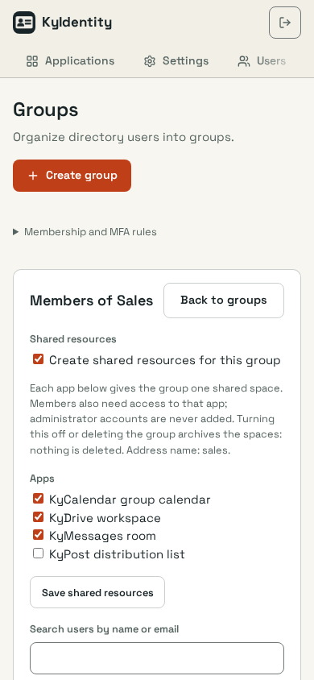
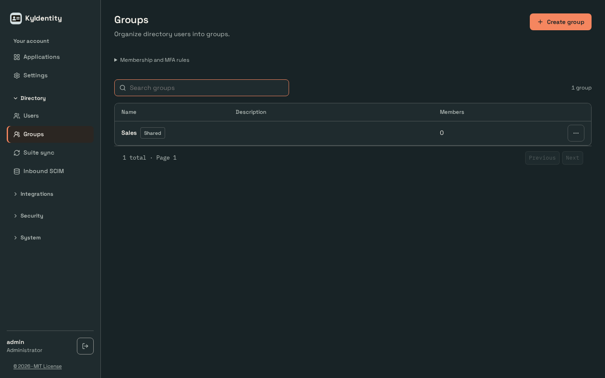
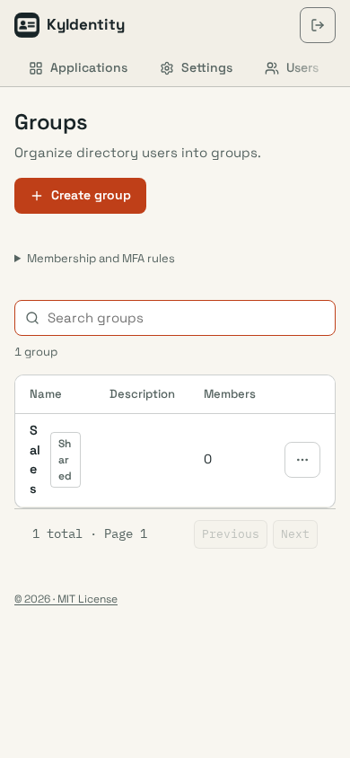

# Suite groups UI captures, 2026-11-15

Captured with `capture.mjs` (driver lib from `ky-redesign/captures/drivers`) against disposable local servers: `before` is `origin/master` at 1830724's parent line (before #247), `after` is this branch. A group "Sales" is created through the UI; no real data. 1440x900 and 390x844, Busnes light and dark. `overflow=0` (no horizontal scroll) for every shot.

| Screen | Before | After |
| --- | --- | --- |
| Group Manage, 1440 light |  |  |
| Group Manage, 390 dark |  |  |
| Shared resources on, 1440 light/dark | |   |
| Shared resources on, 390 light/dark | |   |
| Groups list with the Shared tag | |   |

All other combinations are in `screenshots/`.
