# Mac sign-in (XCreds), 2026-11-19

The Workstation login view gains Linux desktops and Macs sub-headings. The Macs block has the Mac sign-in and require-password state and a generated XCreds configuration profile. The Edit settings dialog gains **Allow Mac sign-in (XCreds)** and **Require a password at sign-in**. "Before" was built from `origin/master` at a86964c.

Driver: `capture.mjs` here, over `~/git/ky-redesign/captures/drivers/lib.mjs`. Each run starts from a fresh bootstrap with the relays off, on port 5391, at 1440x900 and 390x844 in Busnes Light and Dark. In "after", the app has device sign-in, Mac sign-in and require-password on. No shot overflows horizontally (all 20 report `overflow=0`). The issuer in the generated files is the capture server's loopback HTTP issuer; a real one is HTTPS.

| | 1440 light | 1440 dark | 390 light | 390 dark |
| --- | --- | --- | --- | --- |
| Workstation login, before | 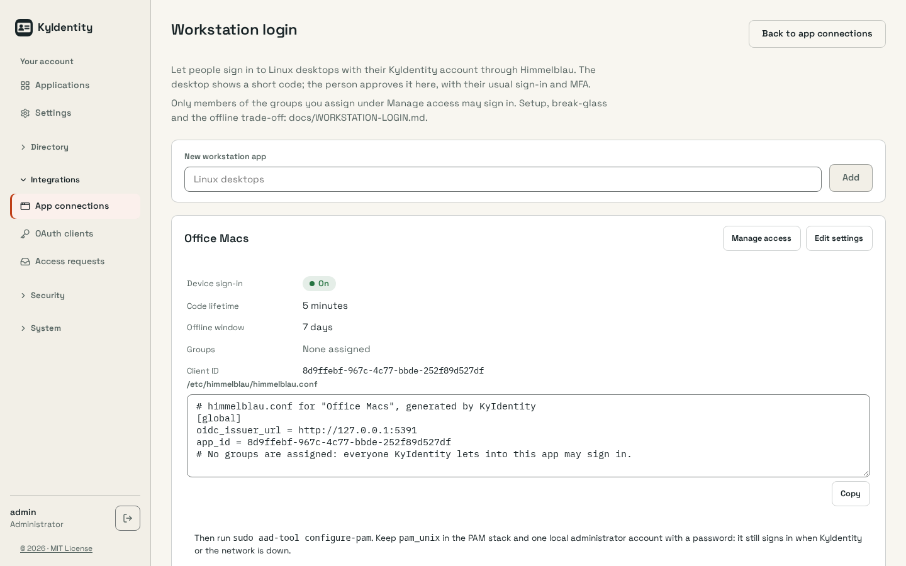 | 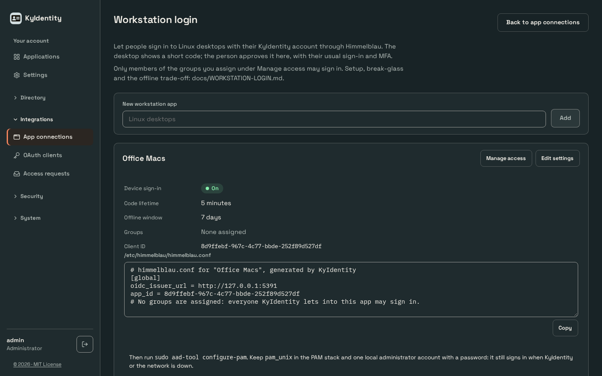 | 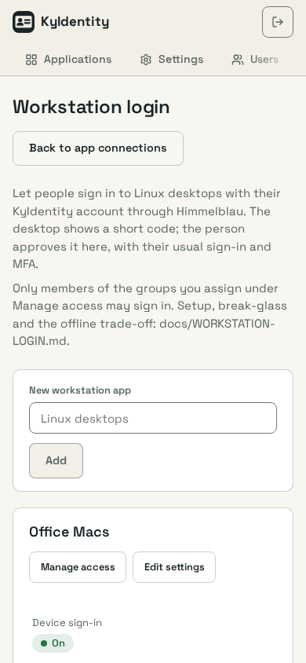 | 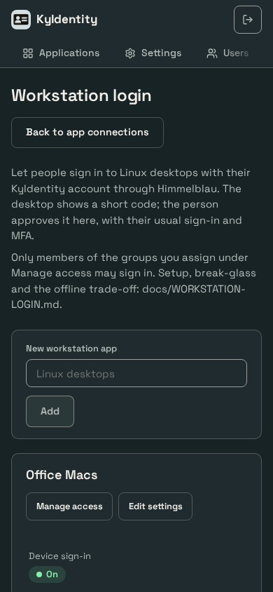 |
| Workstation login, after | 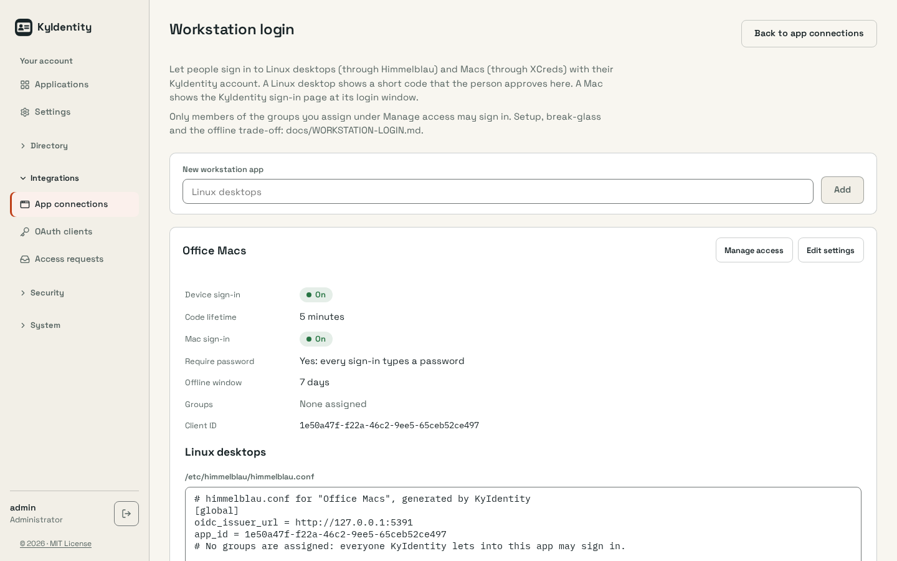 | 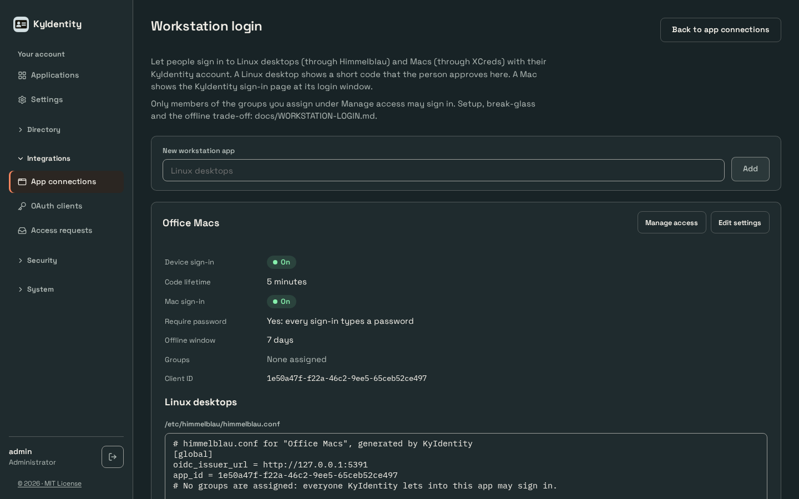 | 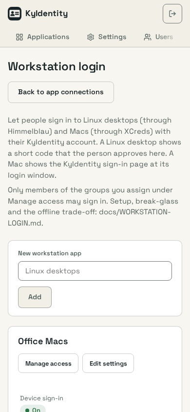 | 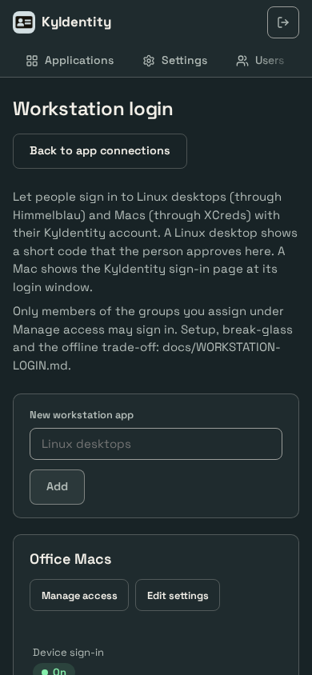 |
| Macs block (after only) | 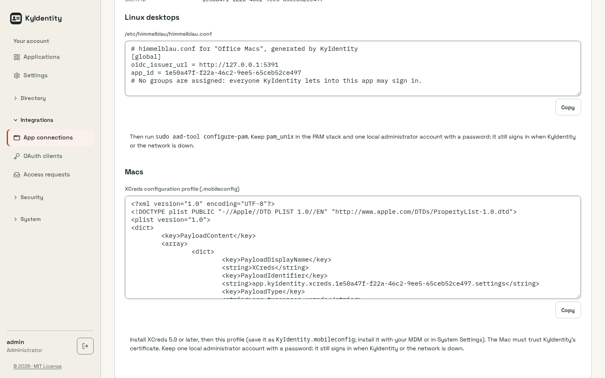 | 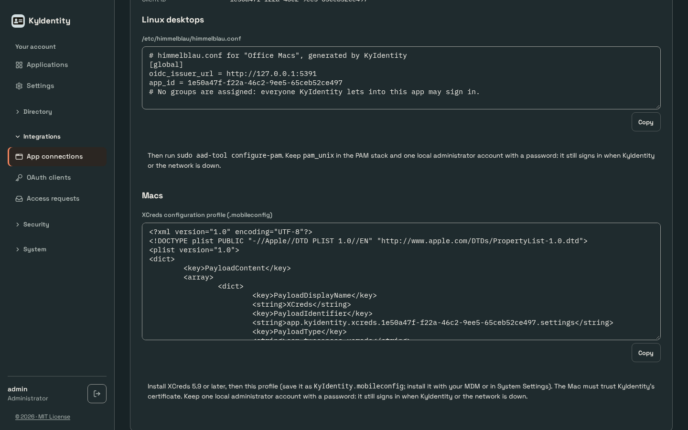 | 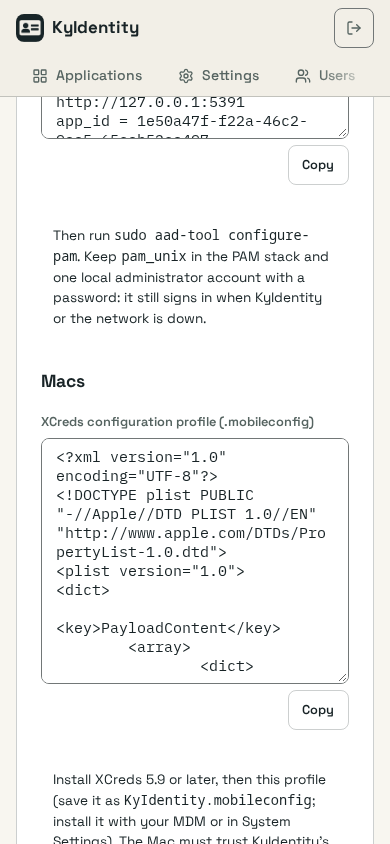 | 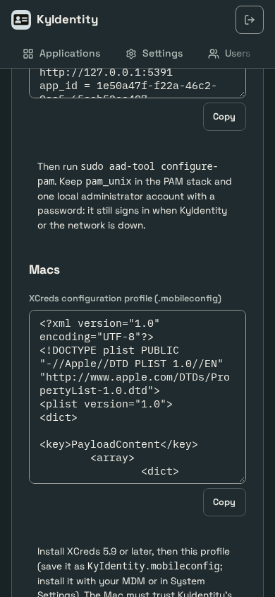 |
| Edit settings, before | 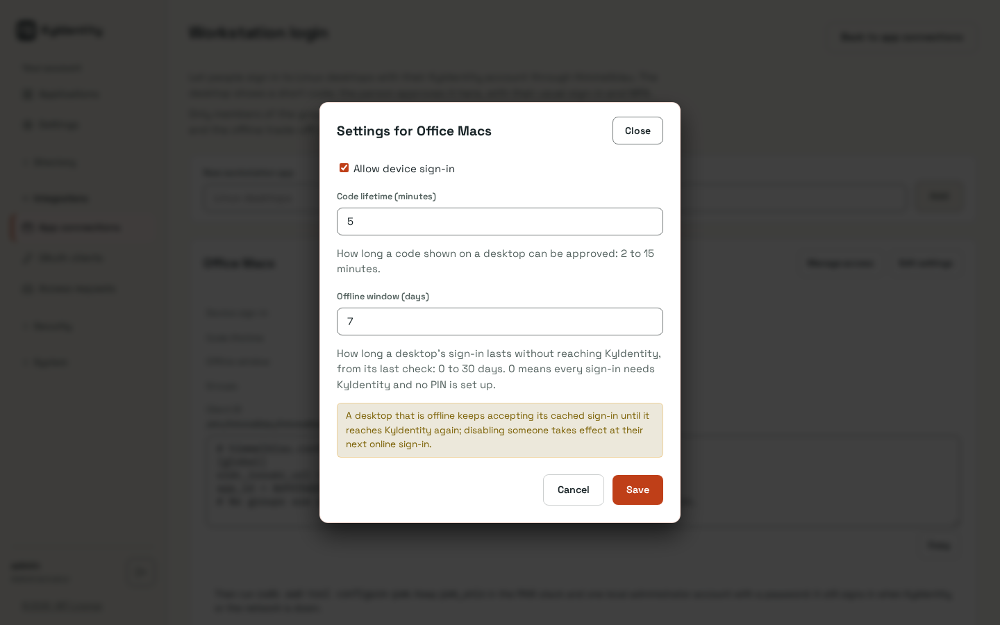 | 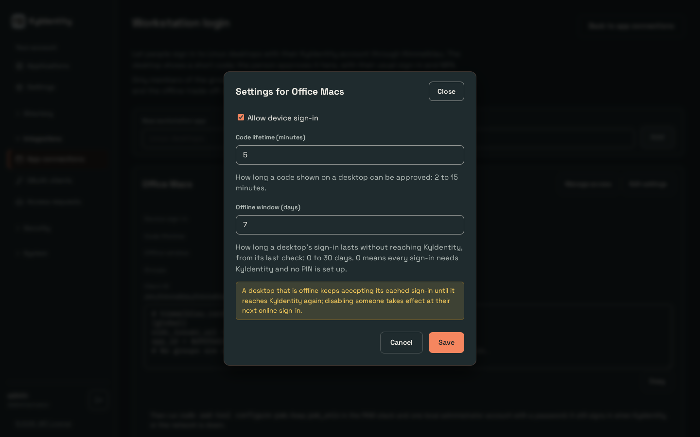 | 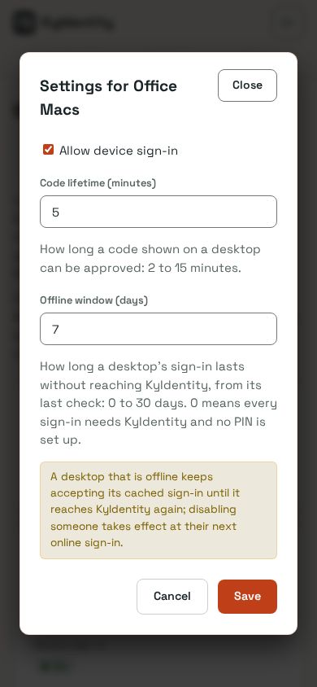 | 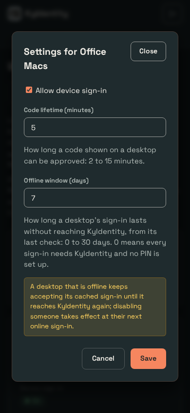 |
| Edit settings, after | 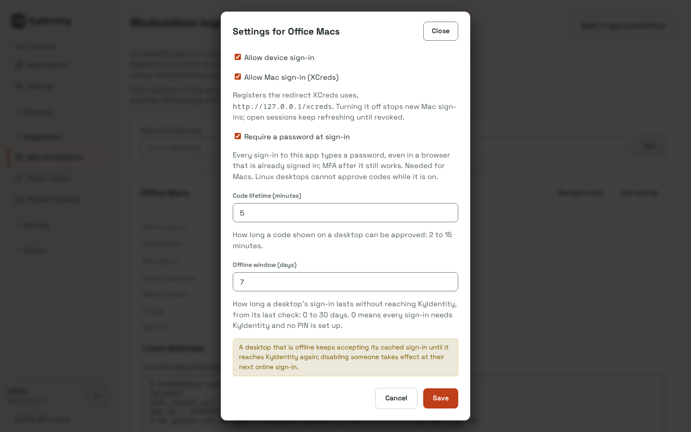 | 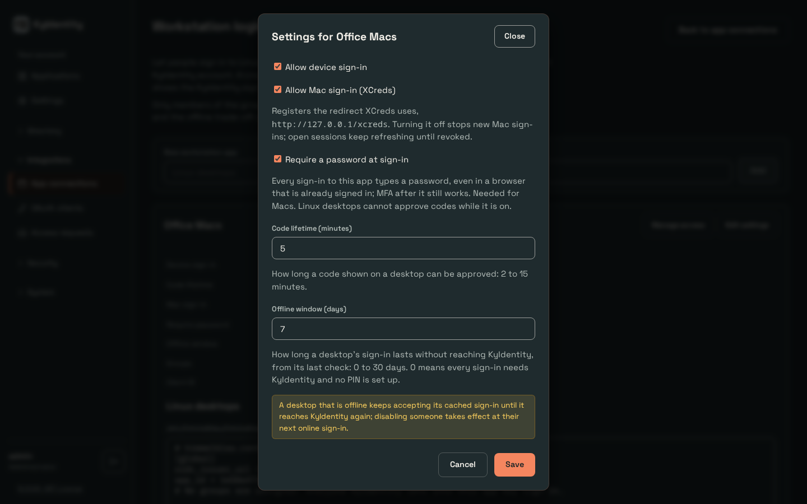 | 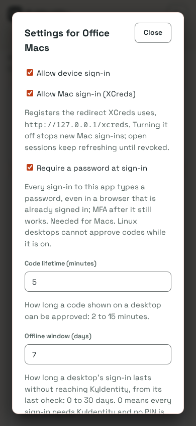 | 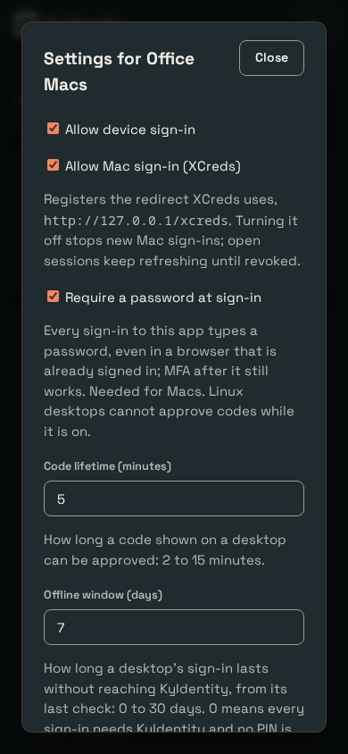 |
